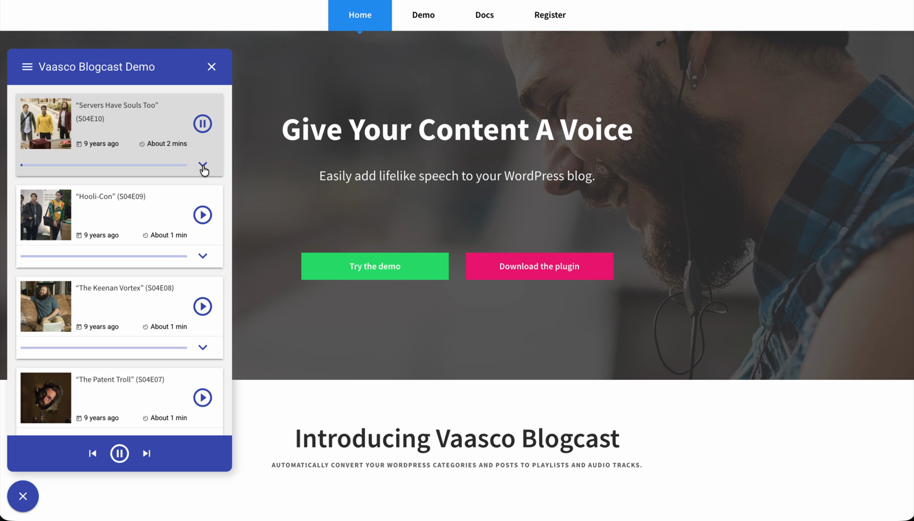

# Vaasco Blogcast

> [!WARNING]
> This project is no longer maintained. It was built in 2017 and is kept here for reference. Issues and pull requests won't be reviewed.

Vaasco Blogcast is a WordPress plugin which automatically converts categories and blog posts to playlists of audio tracks.

Vaasco Blogcast allows visitors listen to your content while driving, working out and in other handfree environments. It also makes your content accessible to users with visual impairments and motor disabilities.

The plugin is powered by Polly, an Amazon AI service that uses advanced deep learning technologies to synthesize speech that sounds like a human voice. This results in high-quality voice output and word pronunciation.

Simply install the Vaasco Blogcast WordPress plugin and add your Amazon Polly credentials to get started. Easily configure options such as widget theme and categories to use through the WordPress admin panel.

## Demo

https://github.com/user-attachments/assets/c572aff6-2d9c-481b-8de4-2eea6e94e959

If the video doesn't play, download it from [docs/demo.mp4](docs/demo.mp4).

## Installation

For detailed instructions on how to install and configure the Vaasco Blogcast WordPress plugin please read [instructions.pdf](instructions.pdf).

## Structure

Vaasco Blogcasts consists of two submodules:

1. Vaasco Blogcast Plugin
2. Vaasco Blogcast Widget

### Vaasco Blogcast Plugin

Located at `src/vaasco-blogcast-plugin`

Contains the PHP code for:

- Vaasco Blogcast plugin installation and activation
- Vaasco Blogcast plugin admin
- Frontend code to embed Vaasco Blogcast widget

More info: `/src/vaasco-blogcast-plugin/README.md`

### Vaasco Blogcast Widget

Located at `src/vaasco-blogcast-widget`

Contains the JavaScript code for the Vaasco Blogcast widget

More info: `/src/vaasco-blogcast-widget/README.md`

## Development

> [!NOTE]
> The build uses gulp 3, which doesn't run on Node 12 or later. It fails with `ReferenceError: primordials is not defined`. To run the gulp tasks, use Node 10 (for example, `nvm use 10`). The build hasn't been updated to gulp 4 or later.

Run the following commands and tasks to load dependencies and build the project:

### Load node dependencies

`npm install`	

Required before running gulp tasks

### Build the widget

`gulp blogcast-widget-build`

### Build the plugin

`gulp blogcast-plugin-build`

### Load the vaasco-widget.html web component

`gulp load-web-components`

### Create a dist directory containing the plugin

`gulp create-dist`

### Create a zip file containing the plugin

`gulp zip-dist`
